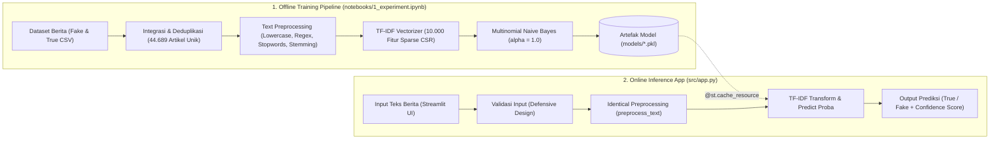

# 📰 Fake News Detector (NLP)

[](https://fake-news-detector-naive-bayes.streamlit.app/)


> **Live Demo:** [fake-news-detector-naive-bayes.streamlit.app](https://fake-news-detector-naive-bayes.streamlit.app/)

---

## 📌 Tentang Proyek Ini

**Fake News Detector** adalah aplikasi web berbasis *Machine Learning* dan *Natural Language Processing* (NLP) untuk mendeteksi indikasi berita palsu (*Fake News*) atau berita asli (*True News*) pada artikel berita berbahasa Inggris secara *real-time*, lengkap dengan persentase tingkat keyakinan (*confidence score*).

**Kenapa proyek ini dibuat?**  
Di era digital, berita bohong menyebar jauh lebih cepat dibandingkan proses verifikasi manual. Proyek ini lahir dari kebutuhan akan alat bantu penyaringan awal yang cepat, ringan, dan mudah diakses oleh siapa saja—sekaligus membuktikan bahwa pendekatan NLP klasik (*TF-IDF + Multinomial Naive Bayes*) mampu memberikan akurasi tinggi dengan biaya komputasi yang sangat rendah, mulai dari tahap eksperimen data hingga siap digunakan di web.

---

## 🎯 Tujuan & Manfaat

Aplikasi ini dirancang untuk:

- **Penyaringan Awal (*Pre-Screening*) Cepat:** Membantu pembaca, peneliti, atau jurnalis mendapatkan sinyal awal apakah pola bahasa suatu artikel berita mengarah ke berita asli atau palsu sebelum melakukan verifikasi fakta (*fact-checking*) mendalam.
- **Referensi *End-to-End* ML Engineering:** Menunjukkan alur kerja lengkap proyek klasifikasi teks—mulai dari *exploratory data analysis* (EDA), pembersihan teks, pelatihan dan evaluasi model, serialisasi artefak, hingga *deployment* aplikasi web interaktif.
- **Baseline Model yang Ringan:** Menjadi acuan sistem deteksi teks yang efisien tanpa memerlukan GPU atau infrastruktur *cloud* yang mahal.

---

## 🛠️ Tech Stack & Arsitektur Sistem

### Tech Stack

| Kategori | Teknologi | Peran dalam Proyek |
| :--- | :--- | :--- |
| **Bahasa Pemrograman** | Python 3 | Bahasa utama untuk eksperimen data, pelatihan model, dan aplikasi web |
| **Machine Learning** | Scikit-Learn | Ekstraksi fitur (`TfidfVectorizer`) dan klasifikasi (`MultinomialNB`) |
| **NLP & Text Cleaning** | NLTK, Regex (`re`) | Pembersihan teks, *stopwords filtering* bahasa Inggris, dan *Porter Stemming* |
| **Data Processing & EDA** | Pandas, NumPy, Jupyter Notebook | Integrasi dataset, analisis distribusi, dan eksperimen pelatihan model |
| **Web Framework** | Streamlit | Antarmuka pengguna (*UI*) interaktif dan *inference server* |
| **Model Serialization** | Joblib | Penyimpanan dan pemuatan artefak model (`.pkl`) secara efisien |
| **Hosting / Deployment** | Streamlit Community Cloud | *Deployment* aplikasi secara *serverless* langsung dari repositori GitHub |

### Arsitektur & Alur Kerja

Sistem ini memisahkan **fase pelatihan (*offline*)** dan **fase inferensi (*online*)** agar aplikasi web tetap ringan, cepat, dan terhindar dari *training-serving skew*.



### Sorotan Desain Teknis

- **Konsistensi Pipeline (*Zero Training-Serving Skew*):** Fungsi `preprocess_text()` di `src/app.py` mereplikasi 100% urutan pembersihan teks dari fase eksperimen (*lowercasing* → hapus URL → hapus karakter non-alfabet → tokenisasi → hapus *stopwords* → *Porter stemming*) agar ruang vektor TF-IDF selalu cocok.
- **Optimasi Memori dengan Caching (`@st.cache_resource`):** Model, *vectorizer*, *stemmer*, dan daftar *stopwords* hanya dimuat **satu kali** ke memori saat aplikasi menyala, bukan setiap kali pengguna menekan tombol prediksi.
- **Dynamic Path Resolution:** Pemuatan file `.pkl` menggunakan jalur dinamis berbasis lokasi file (`os.path`), sehingga aplikasi tetap berjalan stabil dari direktori kerja mana pun.
- **Defensive Design:** Antarmuka dilengkapi validasi input kosong serta peringatan eksplisit mengenai batasan domain model untuk mencegah *error* komputasi maupun salah interpretasi hasil.

### Performa Model

Model dilatih menggunakan *Stratified Train-Test Split* **80:20** (35.751 data latih, 8.938 data uji) dengan **10.000 fitur TF-IDF** dan menghasilkan performa berikut pada data uji:

| Kelas | Precision | Recall | F1-Score | Support |
| :--- | :---: | :---: | :---: | :---: |
| **True News (`0`)** | 0.93 | 0.92 | 0.93 | 4.242 |
| **Fake News (`1`)** | 0.93 | 0.94 | 0.94 | 4.696 |
| **Akurasi Keseluruhan** | **93.23%** | | | **8.938** |

### Struktur Repositori

```text
fake-news-detector/
├── models/
│   ├── naive_bayes_model.pkl     # Model MultinomialNB terlatih
│   └── tfidf_vectorizer.pkl      # TF-IDF Vectorizer terlatih (10.000 fitur)
├── notebooks/
│   └── 1_experiment.ipynb        # Eksperimen EDA, preprocessing, training, & evaluasi
├── src/
│   └── app.py                    # Aplikasi web Streamlit (inference pipeline)
├── requirements.txt              # Daftar dependensi Python
└── README.md
```

> **Catatan:** Direktori `data/` sengaja dikecualikan melalui `.gitignore` agar ukuran repositori tetap ringan. Artefak model siap pakai sudah tersedia di folder `models/`, sehingga Anda bisa langsung menjalankan aplikasi tanpa perlu melatih ulang model.

---

## 🚀 Cara Menjalankan di Lokal & Deploy

### Prasyarat

Pastikan perangkat Anda sudah terinstal:
- **Python 3.8 atau lebih baru**
- **Git** dan **pip**
- Koneksi internet (hanya saat instalasi dependensi dan pengunduhan korpus *stopwords* NLTK pertama kali)

### A. Menjalankan Aplikasi di Lokal

Ikuti langkah-langkah berikut dari awal hingga aplikasi berjalan di browser Anda:

1. **Kloning Repositori**
   ```bash
   git clone https://github.com/ababiliqbal/fake-news-detector.git
   cd fake-news-detector
   ```

2. **Buat dan Aktifkan Virtual Environment** *(sangat direkomendasikan)*

   - **Windows (PowerShell / CMD):**
     ```bash
     python -m venv venv
     venv\Scripts\activate
     ```
   - **macOS / Linux:**
     ```bash
     python3 -m venv venv
     source venv/bin/activate
     ```

3. **Instal Semua Dependensi**
   ```bash
   pip install -r requirements.txt
   ```

4. **Jalankan Server Aplikasi Streamlit**
   ```bash
   streamlit run src/app.py
   ```
   Saat pertama kali dijalankan, aplikasi akan otomatis mengunduh korpus `stopwords` NLTK jika belum tersedia di komputer Anda. Setelah siap, browser akan terbuka secara otomatis pada alamat:
   ```text
   http://localhost:8501
   ```

5. *(Opsional)* **Menjalankan Ulang Eksperimen / Training Model**  
   Jika Anda ingin bereksperimen atau melatih ulang model melalui notebook:
   - Siapkan dataset `Fake.csv` dan `True.csv` di dalam folder `data/`.
   - Jalankan Jupyter Notebook:
     ```bash
     jupyter notebook notebooks/1_experiment.ipynb
     ```
   - Eksekusi seluruh sel untuk menghasilkan ulang artefak `models/naive_bayes_model.pkl` dan `models/tfidf_vectorizer.pkl`.

### B. Cara Deploy ke Streamlit Community Cloud

Aplikasi ini tidak memerlukan API key, database, atau konfigurasi *environment variable* tambahan, sehingga proses *deployment* sangat cepat:

1. *Fork* atau *push* repositori ini ke akun GitHub Anda (pastikan folder `models/`, `src/app.py`, dan `requirements.txt` ikut terunggah).
2. Masuk ke [Streamlit Community Cloud](https://share.streamlit.io/) menggunakan akun GitHub.
3. Klik **Create app** → **Deploy a public app from GitHub**.
4. Pilih repositori dan *branch* target, lalu atur **Main file path** ke:
   ```text
   src/app.py
   ```
5. Klik **Deploy!** — Streamlit akan menginstal dependensi dari `requirements.txt` dan menjalankan aplikasi secara otomatis.

---

## ⚠️ Batasan Sistem (*System Limitations*)

Untuk menjaga akurasi dan interpretasi yang tepat, harap perhatikan batasan berikut:

1. **Bahasa:** Model hanya mendukung teks berita berbahasa **Inggris**. Memasukkan teks bahasa lain akan menghasilkan prediksi yang tidak valid.
2. **Domain Topik:** Model dilatih pada dataset berita bertema **Politik AS, Pemerintahan, dan Isu Global (*World News*)**. Artikel di luar topik tersebut (seperti olahraga, hiburan, fiksi, atau hasil terjemahan mesin yang kurang akurat) berpotensi mengalami *Domain Shift* yang menurunkan akurasi.
3. **Sifat Prediktif:** Sistem menganalisis **pola linguistik dan distribusi kata**, bukan melakukan pengecekan fakta secara langsung ke sumber berita eksternal. Gunakan hasil prediksi sebagai indikasi awal, bukan kebenaran mutlak.
